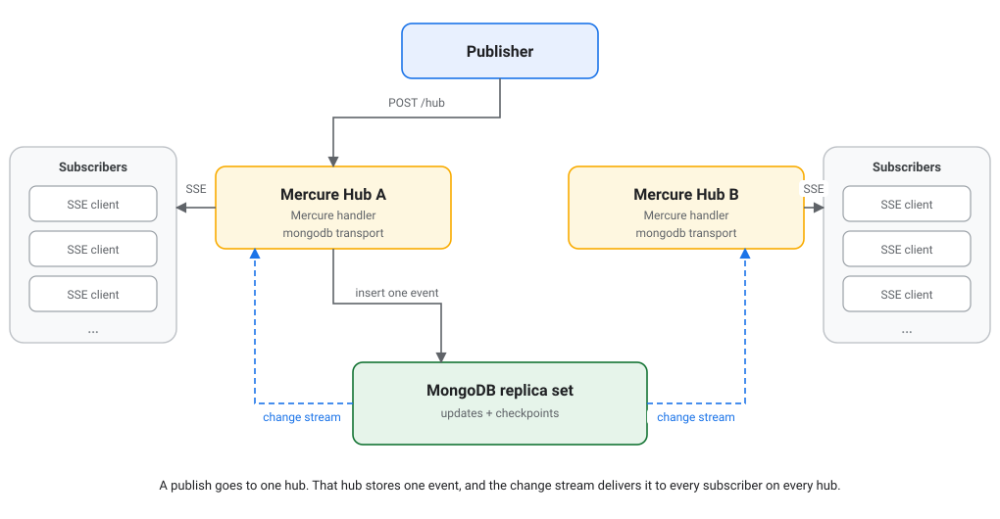

# mercure-mongodb

[](https://github.com/GromNaN/mercure-mongodb/actions/workflows/ci.yml)
[](LICENSE)
[](https://go.dev/)

A [MongoDB](https://www.mongodb.com/) transport for the [Mercure](https://mercure.rocks) hub.

Did you know Mercure is modular? Mercure pushes live events to clients over
Server-Sent Events. The open source hub works well on its own: it keeps the
history in memory, which is simple and fast. But memory does not survive a
restart, and a single machine caps how many clients you can serve.

For resilience and scalability, you change one part: the transport. This
transport stores the update history in MongoDB and shares it between hub
instances through a MongoDB change stream. MongoDB is the only shared service:
there is no Redis, no Kafka, and no other broker.

- **Durable history.** A client that reconnects with `Last-Event-ID` is replayed
  from MongoDB, even if it lands on another hub instance.
- **Multi instance by default.** Every hub reads the same change stream, so a
  publish on one instance reaches subscribers on all of them.
- **One dependency to operate.** The same MongoDB deployment serves storage and
  fan out.

The transport plugs into the standard Mercure hub. The protocol, the HTTP
endpoints, JWT authorization and the SSE server stay in Mercure. This project
only provides storage and cross instance synchronization.

## Table of contents

[How it works](#how-it-works) • [Requirements](#requirements) • [Quick start](#quick-start) • [Docker](#docker) • [Configuration](#configuration) • [Guarantees and limits](#guarantees-and-limits) • [Multi instance](#multi-instance) • [When to use Mercure Enterprise](#when-to-use-mercure-enterprise) • [Production notes](#production-notes) • [Load testing](#load-testing) • [Development](#development) • [License](#license)

## How it works

Each update is one immutable document in an `updates` collection. Every hub
instance opens a change stream on that collection. A publish appends a document;
the change stream delivers it to every hub, including the one that published, so
there is a single ordered delivery path and no duplicate.



On a reconnect, a hub replays the history from MongoDB, then continues with live
delivery. The change stream carries a resume token, so a hub that restarts picks
up where it stopped. If the stream ever skips an event, the hub reads the
missing range from the collection before it delivers the next one, so a
subscriber never sees a gap or a duplicate. See
[`docs/adr/0001-mongodb-transport.md`](docs/adr/0001-mongodb-transport.md) for
the full design and its trade-offs.

## Requirements

- A MongoDB replica set. Change streams need a replica set, so a standalone
  server is rejected when the transport connects. A sharded cluster is not
  supported either.
- A Caddy build that includes the Mercure handler and this transport.

Supported versions:

| Component           | Version          |
| ------------------- | ---------------- |
| Mercure             | v1.1.0           |
| Caddy               | v2.11.7          |
| Go                  | 1.27             |
| MongoDB Go driver   | v2.9.2           |
| MongoDB server      | 6.0 or newer     |

## Quick start

### 1. Start a development replica set

```console
docker compose up -d --wait
```

This starts [MongoDB Atlas Local](https://www.mongodb.com/docs/atlas/cli/current/atlas-cli-local-deploy/)
on `localhost:27017`. It is a single node replica set that initializes itself, so
change streams work out of the box. The `--wait` flag returns once the image
healthcheck passes.

### 2. Build the hub

```console
xcaddy build \
  --with github.com/dunglas/mercure/caddy \
  --with github.com/GromNaN/mercure-mongodb
```

### 3. Configure the hub

Use the example configuration, or write your own:

```caddyfile
http://localhost:3000 {
	mercure {
		transport mongodb {
			uri {$MERCURE_MONGODB_URI}
			database mercure
			collection updates
			retention 10000
		}

		issuer http://localhost:3000 {
			publisher {
				jwt {env.MERCURE_PUBLISHER_JWT_KEY} HS256
			}
			subscriber {
				jwt {env.MERCURE_SUBSCRIBER_JWT_KEY} HS256
			}
		}
	}
}
```

The `issuer` block declares a trusted token issuer and its verification
keys, as RFC 9068 requires. The hub serves the endpoint at
`/.well-known/mercure`.

See [`examples/Caddyfile`](examples/Caddyfile) for the full file.

### 4. Run the hub

```console
export MERCURE_MONGODB_URI='mongodb://localhost:27017/?directConnection=true'
export MERCURE_PUBLISHER_JWT_KEY='change-me'
export MERCURE_SUBSCRIBER_JWT_KEY='change-me'
./caddy run --config examples/Caddyfile
```

The hub is now available at `http://localhost:3000`.

### 5. Publish and subscribe

Mint two tokens for the development keys with the `mercure-token` command of
the hub binary. It mints an RFC 9068 access token carrying the RFC 9396
`authorization_details` claim.

```console
ISSUER='http://localhost:3000'
AUDIENCE='http://localhost:3000/.well-known/mercure'

PUBLISHER_JWT=$(printf '%s' "$MERCURE_PUBLISHER_JWT_KEY" | ./caddy mercure-token \
  --iss "$ISSUER" --aud "$AUDIENCE" --key @- --publish '*')
SUBSCRIBER_JWT=$(printf '%s' "$MERCURE_SUBSCRIBER_JWT_KEY" | ./caddy mercure-token \
  --iss "$ISSUER" --aud "$AUDIENCE" --key @- --subscribe '*')
```

Subscribe in one terminal. The `match` parameter does an exact-match
subscription on the topic:

```console
curl -N 'http://localhost:3000/.well-known/mercure?match=https%3A%2F%2Fexample.com%2Fbooks%2F1' \
  -H "Authorization: Bearer $SUBSCRIBER_JWT"
```

Publish in another:

```console
curl -X POST http://localhost:3000/.well-known/mercure \
  -H "Authorization: Bearer $PUBLISHER_JWT" \
  --data-urlencode 'topic=https://example.com/books/1' \
  --data-urlencode 'data=hello'
```

The subscriber receives the update through MongoDB.

## Docker

Prebuilt images are published to the GitHub Container Registry on every version
tag: `ghcr.io/gromnan/mercure-mongodb`. They bundle the Mercure hub and this
transport, so there is nothing to build. A stable release publishes the version
tag and moves `latest`; a prerelease publishes only its version tag, so `latest`
always points at the newest stable release.

The image runs the default [`Caddyfile`](Caddyfile), which reads its
configuration from the environment.

| Variable                     | Default              | Description                                           |
| ---------------------------- | -------------------- | ----------------------------------------------------- |
| `MERCURE_MONGODB_URI`        |                      | MongoDB connection string, on a replica set. Required. |
| `MERCURE_PUBLISHER_JWT_KEY`  |                      | Publisher JWT key. Required.                          |
| `MERCURE_SUBSCRIBER_JWT_KEY` |                      | Subscriber JWT key. Required.                         |
| `SERVER_NAME`                | `localhost`          | Public address the hub listens on.                    |
| `MERCURE_TRUSTED_ISSUERS`    | `https://localhost`  | Trusted token issuer identifier (the token `iss`).    |
| `MERCURE_MONGODB_DATABASE`   | `mercure`            | Database that holds the events and checkpoints.       |
| `MERCURE_MONGODB_COLLECTION` | `updates`            | Collection of update documents.                       |
| `MERCURE_MONGODB_RETENTION`  | `10000`              | Number of newest updates kept. `0` keeps everything.  |
| `MERCURE_PUBLISHER_JWT_ALG`  | `HS256`              | Publisher JWT algorithm.                              |
| `MERCURE_SUBSCRIBER_JWT_ALG` | `HS256`              | Subscriber JWT algorithm.                             |

Start a MongoDB replica set and the hub on the same network. The hub starts
whether or not MongoDB is ready: it opens the connection on first use and retries
with backoff, so it recovers on its own once the replica set finishes
initializing.

The image ships a healthcheck that reads `/mercure/health/ready` on the Caddy
admin API, on `127.0.0.1:2019` by default. The hub answers 503 there until the
change stream is up and MongoDB answers a ping, so the container reports
unhealthy while MongoDB is unreachable, and the orchestrator keeps it out of
rotation. Point a Kubernetes readiness probe at the same endpoint.

```console
docker network create mercure
docker run -d --name mongodb --network mercure \
  mongodb/mongodb-atlas-local:latest
# The image ships a healthcheck, so this returns once the replica set is ready.
until [ "$(docker inspect -f '{{.State.Health.Status}}' mongodb)" = healthy ]; do sleep 1; done
docker run -d --name mercure --network mercure -p 3000:3000 \
  -e SERVER_NAME=:3000 \
  -e MERCURE_TRUSTED_ISSUERS='http://localhost:3000' \
  -e MERCURE_MONGODB_URI='mongodb://mongodb:27017/?directConnection=true' \
  -e MERCURE_PUBLISHER_JWT_KEY='change-me' \
  -e MERCURE_SUBSCRIBER_JWT_KEY='change-me' \
  ghcr.io/gromnan/mercure-mongodb:latest
```

The hub is available at `http://localhost:3000`, and the endpoint is
`/.well-known/mercure`. Mint tokens with the `mercure-token` command inside the
image:

```console
PUBLISHER_JWT=$(printf '%s' 'change-me' | docker exec -i mercure caddy mercure-token \
  --iss 'http://localhost:3000' --aud 'http://localhost:3000/.well-known/mercure' \
  --key @- --publish '*')
SUBSCRIBER_JWT=$(printf '%s' 'change-me' | docker exec -i mercure caddy mercure-token \
  --iss 'http://localhost:3000' --aud 'http://localhost:3000/.well-known/mercure' \
  --key @- --subscribe '*')
```

Then publish and subscribe as in the [quick start](#quick-start).

The token `iss` must match `MERCURE_TRUSTED_ISSUERS`, and its `aud` must
contain the resource identifier: the public URL the client contacted, plus
`/.well-known/mercure`. When the hub sits behind a reverse proxy, set
`MERCURE_TRUSTED_ISSUERS` to the issuer your application mints tokens with,
and, for a stable audience across domains, pin it with the
`resource_identifier` directive through `MERCURE_EXTRA_DIRECTIVES`. See
[`Caddyfile`](Caddyfile) for the full default configuration, and mount your own
file at `/etc/caddy/Caddyfile` to replace it.

## Configuration

The transport is configured with the `mongodb` block inside `mercure`:

```caddyfile
mercure {
	transport mongodb {
		uri mongodb://localhost:27017/?directConnection=true
		database mercure
		collection updates
		retention 10000
	}
}
```

| Directive             | Default       | Description                                                        |
| --------------------- | ------------- | ------------------------------------------------------------------ |
| `uri`                 |               | MongoDB connection string. Required. It may contain credentials.   |
| `database`            | `mercure`     | Database that holds the events and checkpoints.                    |
| `collection`          | `updates`     | Collection of update documents.                                    |
| `checkpoints`         | `checkpoints` | Collection of hub checkpoints (change stream resume tokens).      |
| `seen`                | `seen_ids`    | Collection of visible ID markers, bounded to the retention window. |
| `retention`           | `0`           | Number of newest updates kept. `0` keeps everything.               |
| `cleanup_interval`    | `30s`         | How often the retention cleanup runs.                              |
| `checkpoint_interval` | `1s`          | How often the resume token is saved.                               |
| `watch_await_time`    | `1s`          | Maximum time the change stream waits for a batch.                  |
| `connect_timeout`     | `10s`         | Connection and server selection timeout.                           |

Keep credentials out of the Caddyfile. Pass the connection string through the
`MERCURE_MONGODB_URI` environment variable, as in the example above. The
transport never logs the connection string.

## Guarantees and limits

- **At least once.** An update is persisted once and delivered at least once to
  a connected subscriber. A publisher retry after an ambiguous write error can
  store the same update twice. Duplicates are possible; gaps are not.
- **`Last-Event-ID`.** A reconnect replays the updates published after the given
  ID. When the ID is unknown, or was removed by retention, the hub answers with
  `earliest` so the client can reload its state.
- **Change stream dependency.** Delivery needs a healthy change stream. The
  transport reports its health through `Ready` and `Live`, and reconnects with
  exponential backoff. A hub that loses the stream catches up from the durable
  collection before it reports itself ready.
- **Startup tolerates an unreachable MongoDB.** Provisioning does not contact
  MongoDB. The consumer opens the connection on first use and retries it with
  backoff, so a hub that starts before MongoDB is ready, or while it is down,
  starts anyway and connects on its own. A publish or a subscriber that arrives
  during the outage fails, and the client retries. `Ready` reports not ready
  until the change stream is up and MongoDB answers a ping, so a hub that
  started without MongoDB stays out of rotation. A definitive failure, such as a
  wrong password, is logged and retried, never reported as a startup error.
- **Count-based retention only.** Retention keeps the newest N updates. There is
  no age-based expiry. Size `retention` above the worst expected subscriber lag,
  because a subscriber that falls further behind than the window is disconnected
  and fast forwarded, so the client reconnects and replays what remains.
- **Do not drop the collection while hubs run.** Dropping or renaming the
  `updates` collection restarts the internal sequence. The transport logs an
  error and resets its watermark. This is a destructive operator action.

Non-goals:

- This project does not implement the Mercure protocol, the HTTP endpoints, JWT
  authorization or the SSE server. Those stay in the Mercure hub.
- It does not persist subscribers. Subscribers and their SSE connections live in
  hub memory and are lost on restart, as in every Mercure transport.
- It does not provide exactly-once delivery.

## Multi instance

Run as many hub instances as you need, all pointing at the same database and
collection. Each instance keeps its own SSE connections in memory and its own
change stream. A subscriber connects to one instance; a publish on any instance
reaches it through MongoDB.

Give each instance a distinct Caddy `name` so their checkpoints do not collide.
Two instances with the same name share one checkpoint, which only affects resume
after a restart, not correctness.

For publishing, prefer a single writer. Two instances that publish at the same
time collide on the next sequence value and retry. The transport resolves this
correctly, but it is more efficient to elect one instance and send every publish
to it. The writer is only a sequence allocator, so a failover is safe. Delivery,
replay and `Last-Event-ID` are not affected. See the ADR for the trade-off.

## When to use Mercure Enterprise

This transport covers hubs backed by MongoDB. Mercure also ships
[Enterprise transports](https://mercure.rocks/pricing) on Redis/Valkey,
PostgreSQL, Kafka and Pulsar. They are not better in general, but they fit
better in a few cases:

- **Cluster-wide subscriptions.** The Redis/Valkey transport shares the
  subscriber list across instances, so the subscription API reports presence
  for the whole cluster. Here, `GetSubscribers` reports only the subscribers
  connected to the local instance.
- **A backend you already run.** If your team already operates PostgreSQL,
  Kafka, Pulsar or Redis and does not run MongoDB, an Enterprise transport
  avoids adding a new stateful service. The "one dependency to operate" claim
  above only holds when that dependency is MongoDB.
- **Broker managed retention.** Retention here is count based only. The Kafka,
  Pulsar and Redis/Valkey transports delegate retention to the broker, which
  can match an existing time or size based data policy.
- **Queryable history.** The PostgreSQL transport keeps history in a table you
  can query for diagnostics and analytics.
- **Commercial support.** Mercure Enterprise and Mercure Cloud include
  maintainer support and response time commitments. This project is AGPL 3.0,
  community maintained, with no SLA.

If none of these applies, this transport is a good fit: durable history, a
global gapless order, multi-instance delivery and replay, with MongoDB as the
only shared service.

## Production notes

- **Write concern.** The transport writes with `w:majority` and reads from the
  primary, so the internal sequence stays gapless across a failover.
- **Minimal MongoDB permissions.** The transport needs `readWrite` on the
  database that holds the events and checkpoints collections. Grant nothing
  more.
- **Indexes.** The transport creates its indexes when it connects. The `_id`
  index serves replay, retention and cursor order.
- **Oplog window.** A longer oplog lets a hub resume a change stream after a
  longer outage without a full catch up. Size the oplog for the outage you want
  to tolerate.
- **Backups.** Back up the `updates`, `seen_ids` and `checkpoints` collections
  with your usual MongoDB tooling. The `updates` collection is the durable
  history, and `seen_ids` decides whether a visible ID is new, so restoring only
  `updates` can make a reused ID look new.
- **Reverse proxy.** Configure your proxy to keep SSE connections open: disable
  response buffering and raise the read timeout above the hub heartbeat.
- **Observability.** The transport exposes `Ready`, `Live` and `Lag`. `Ready`
  answers nil only when the change stream is connected and caught up and MongoDB
  answers a ping. `Live` never fails on a MongoDB outage: a restart cannot fix
  MongoDB, and it would restart every hub at once. A hub that reports not ready,
  or a growing lag, points to a change stream or MongoDB problem.
- **Troubleshooting.** A hub that starts but never reports ready logs the MongoDB
  connection failure: check that the deployment is a replica set and that `uri`
  is set. If clients stop receiving updates, check the change stream health and
  the MongoDB logs.

## Load testing

The repository includes a small SSE load generator in [`load`](load). It opens
many concurrent subscriptions, publishes a stream of updates, and reports the
publish to client latency.

```console
go run ./load \
  -hub http://localhost:3000/.well-known/mercure \
  -publish-token "$PUBLISHER_JWT" \
  -subscribe-token "$SUBSCRIBER_JWT" \
  -clients 2000 -messages 2000
```

Run it against the hardware and configuration you plan to use, and publish the
results with that context. The numbers depend on the machine, the network, the
MongoDB deployment and the topic fan-out. They are not a guarantee for other
setups.

## Development

Run the unit tests. They need no MongoDB:

```console
make test
```

Run the integration tests against a replica set:

```console
docker compose up -d --wait
make test-integration
```

The integration tests are skipped unless `MONGODB_URI` is set. They require a
replica set, because change streams are not available on a standalone server.

## License

This project is under the [AGPL 3.0 license](LICENSE).

The image and the release archives bundle three works:

| Work            | License    | License file                                                          |
| --------------- | ---------- | --------------------------------------------------------------------- |
| mercure-mongodb | AGPL 3.0   | [`LICENSE`](LICENSE)                                                  |
| Mercure hub     | AGPL 3.0   | [`LICENSE`](https://github.com/dunglas/mercure/blob/main/LICENSE)     |
| Caddy           | Apache-2.0 | [`LICENSE`](https://github.com/caddyserver/caddy/blob/master/LICENSE) |

The hub serves users over a network, so the AGPL network clause applies: if you
run a modified version, you must offer its source to the users it serves.
